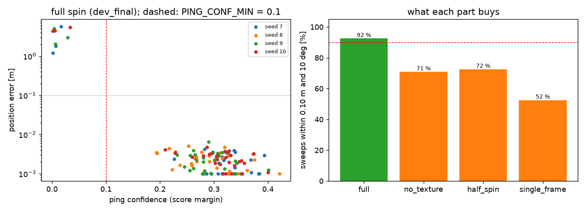
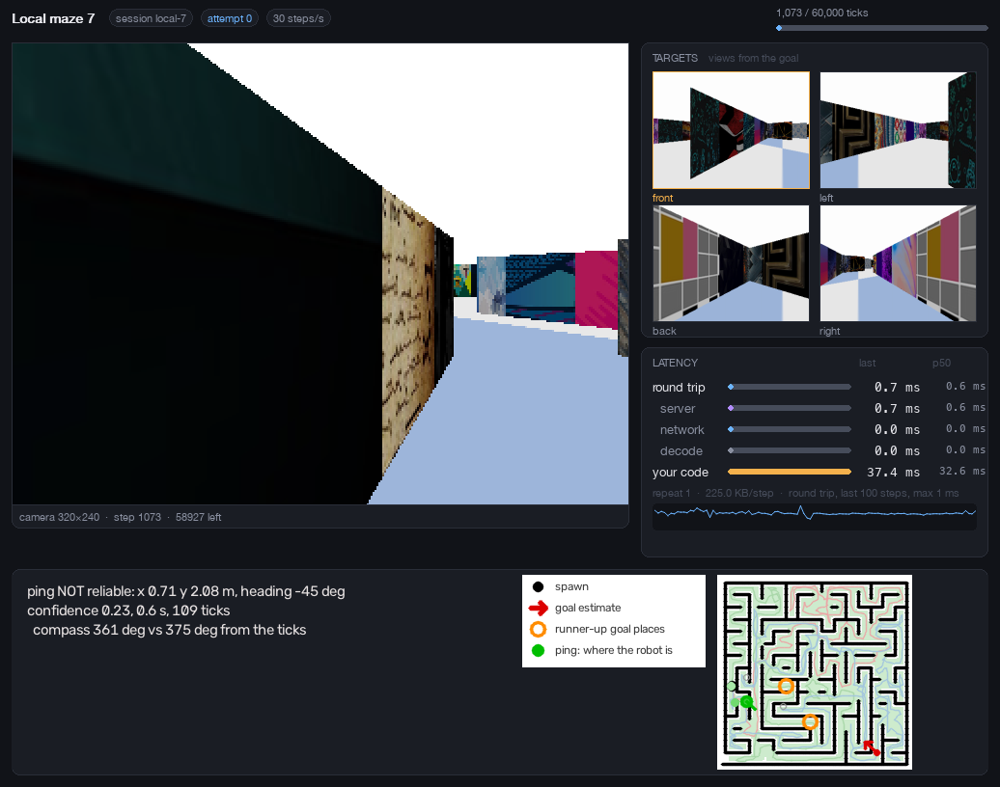

# Stage 10: ping, locate the robot on the map on demand

Plan revision in force: **revision 10** (read from disk; stage 10).

Status: **built, and every criterion that can run without you passes on dev seeds. Two items wait for you:** the test sweeps (the plan says to ask first) and your own look at the green circle in `--local 7`.
- **Dev sweeps:** 92.5 % of 120 are within 0.10 m and 10° (target ≥ 90 %); median error 2.3 mm and 0.24°; all 9 failures are flagged not reliable, none at high confidence.
- **Speed:** after the spin, `locate` takes a median 0.53 s (max 0.66 s) on a quiet machine (target < 1 s). The frames are processed during the spin (7 ms each).
- **`goal.py`:** the generalisation leaves goal placement **byte-identical** on all four dev goals.
- **In the live window** (the real SDK loop with the window on a dummy display): all 8 pings in two runs were within 12 mm and 0.8° of the simulator's true pose.

## What was built

| file | what |
|---|---|
| `source/mapping/ping.py` (new, pipeline) | `Sweep` (`start`, `add`, `relative_angles`, `done`, `problems`), `merged_scan`, `locate` |
| `source/mapping/goal.py` | one change: a view may carry its own angle (`views` entries `(k, img, rows, top, status[, angle])`); without one, the old `k * pi / 2` expression |
| `source/my_agent.py` | P key: `act()` reads the keys once; the spin; locate in the same step; the green circle, last five pings, status text, legend entry |
| `source/mapping/stage10.py` | evaluation: random free positions, simulated sweeps, scoring, ablations, tables and figures. Test seeds refused without `--allow-test`, holdout always |
| `tests/mapping/test_ping.py` | 12 tests (below) |
| `data/ping-7` ... `ping-10` | 30 recorded sweeps per dev seed: JPEG frames and the true poses |
| `cache/mapping/stage10/*.json`, `reports/figures/stage10_dev_final.png`, `stage10_window_live_dev7.png` | numbers and figures |

Reproduce:
```
uv run python source/mapping/stage10.py record 7 8 9 10 --n 30
uv run python source/mapping/stage10.py run 7 8 9 10 --tag dev_final --variants full,no_texture,half_spin,single_frame
uv run python source/mapping/stage10.py report 7 8 9 10 --tag dev_final && uv run python source/mapping/stage10.py figures 7 --tag dev_final
```
The dev maps are `cache/mapping/build/gt4-{7,8,9,10}/map.npz`, each built from that seed's exploration data by `build_map.py` (the same way as at test time).

## Method

- **A spin, not a frame.** A single 120° view is often ambiguous; a 360° spin gives the panorama that `goal.place` handles for the goal views. The robot turns about its camera, so the position does not change. Cost: about 105 ticks.
- **Relative angles from the compass, not from the ticks.** The compass (heading modulo 90°) is absolute, so its unwrapped series telescopes: frame i is turned by `psi_i − psi_0 + 90 n` degrees with no accumulated drift, `n` counted from the 3.4° steps between frames. Frames without a reading are interpolated, the ends extrapolated. The tick count (3.44° per LEFT tick, with motion noise and any per-route turn bias) is only a consistency check.
  - **Long gaps:** across a run of missing compass readings longer than 30° the quarter turn is ambiguous, and the ticks pick the multiple of 90° (tolerance ±45°, which covers a 20 % turn bias). I added this after a dev failure (below).
- **Merged scan.** Each kept frame (every third tick, about 35) gives its virtual scan (robot camera height 0.21 m), cut to a 12° bearing slice around its optical axis (the kept frames are 10.3° apart), rotated by its angle into the first frame's frame. Six of the frames (every sixth kept one, about 60° apart) go to the texture term as angled views.
- **Placement.** `goal.place` on the merged scan (unchanged search, refinement, texture term and confidence). The robot's pose at the end of the spin is the first frame's pose plus the total turn.
- **Reliable** means confidence ≥ `PING_CONF_MIN` = **0.10** and no warning.
- **Chosen on dev:** slice 12°, six texture views and `KEEP_EVERY` 3: accuracy was insensitive (95 to 97 % on the first 60 sweeps), so I took the principled setting (a slice a little wider than the frame spacing) and fewer texture views for speed. `PING_CONF_MIN` is the geometric middle of the gap between the highest confidence of a failure and the lowest of a success (see Results).

## Task 3: `goal.py` is byte-identical

Before and after the change, `goal.place` on the dev goals (seeds 7 to 10, `target.jpg`, stage 7's maps), compared as raw bytes: pose, confidence, the three distinct candidates with their scores, camera height, overlap residual and point count: **identical on all four**, and so is the pickle of all results. A test also checks that views with explicit angles `k * pi / 2` give the same placement and texture score as views without.

## Results (dev seeds, 120 sweeps)

A sweep: a random free position at least 0.15 m from the walls, a random heading, LEFT ticks (0.06 rad, 10 % per-tick noise) until the compass says 360°, one rendered frame per tick (`msaa=4`), stored as JPEG. The pose that counts is the one at the end of the spin. Figure: `stage10_dev_final.png`.

| seed | sweeps | within 0.10 m and 10° | median error | p90 error | reliable | failures (all flagged?) | locate time, median / max (6 jobs in parallel) |
|---|---|---|---|---|---|---|---|
| 7 | 30 | 90.0 % | 2.3 mm, 0.23° | 123.7 mm, 0.67° | 27 | 3 (yes) | 0.83 s / 1.00 s |
| 8 | 30 | 100.0 % | 2.4 mm, 0.28° | 3.7 mm, 0.65° | 30 | 0 | 0.89 s / 1.03 s |
| 9 | 30 | 90.0 % | 2.1 mm, 0.23° | 206.9 mm, 9.66° | 27 | 3 (yes) | 0.91 s / 1.47 s |
| 10 | 30 | 90.0 % | 2.7 mm, 0.22° | 445.2 mm, 9.71° | 27 | 3 (yes) | 0.97 s / 1.25 s |
| **all** | **120** | **92.5 %** | **2.3 mm, 0.24°** | 4.7 mm, 0.69° | 111 | **9 (yes)** | 0.90 s / 1.47 s |



**Confidence separates right from wrong.** The 9 failures have confidence 0.001 to 0.033 (seven have a heading wrong by 90° or 180°, two have the right heading and a position in another corridor); the 111 successes have 0.194 to 0.42 (5th percentile 0.23). A threshold anywhere in that gap separates the recorded sweeps perfectly; `PING_CONF_MIN` is **0.10**, its geometric middle. It is the same number as stage 8's goal threshold, but it was chosen here from this gap, not carried over. At 0.10: 111 of 120 reliable, 0 high-confidence failures, 0 correct pings flagged.

**Speed.** The table's times were measured with six sweeps scored in parallel on a machine running other jobs, so they are pessimistic. Sequentially, one process, on a quiet machine, 20 sweeps (seeds 7 to 10): **`locate` median 0.54 s, p90 0.62 s, max 0.67 s**, all CPU. `Sweep.add` costs 7 ms per frame and runs during the spin. In the live window `locate` took 0.53 to 0.76 s, and the panel redrew in the same step.

**What each part buys** (same 120 sweeps; the full spin is the first row):

| variant | within 0.10 m and 10° | median error | reliable at 0.10 | high-confidence failures |
|---|---|---|---|---|
| full spin, texture term | **92.5 %** | 2.3 mm, 0.24° | 111 / 120 | **0** |
| no texture term | 70.8 % | 3.0 mm, 0.28° | 3 / 120 | 0 |
| half spin (180°) | 72.5 % | 4.0 mm, 0.34° | 87 / 120 | 0 |
| single frame (no spin) | 52.5 % | 8.8 mm, 0.63° | 64 / 120 | 1 |

At the final threshold the weaker variants are mostly honest about it: a single frame is right about half the time and says so (64 of 120 pass the bar, 1 of them wrong). What the full spin adds is that the answer is both mostly right and mostly trusted: 111 of 120 pass the bar and none is wrong. The texture term is what resolves aliases that geometry alone leaves tied: without it only 3 sweeps clear the bar.

**JPEG against raw frames.** The sweeps were stored as JPEG (quality 90, the recordings' format). A live local session hands the agent unencoded frames, so I scored the first 8 sweeps per seed again from raw renders: 30 of 32 within 0.10 m and 10° (JPEG: 30 of 32 on the same sweeps), median error 1.5 mm and 0.12°, 0 high-confidence failures.

## Two bugs found by the evaluation, and fixed

1. **Valid but wrong compass readings.** One dev sweep (seed 9, #3) ran 157 ticks: the compass said the robot had turned 361°, but it had turned 541°. The cause was not missing readings, as I first thought and wrote down: the compass gave a few readings that were valid and wrong by about 45° (for example −36° where the truth was 9°; stage 3 measured such frames), and the chain of angles followed them. My first fix, which uses the ticks to resolve whole quarter turns across long gaps, did not touch this sweep; I only noticed because I re-checked the sweep instead of trusting the summary. The fix that works: a reading is accepted only if its step from the last accepted one fits the turn rate seen so far (within 10° plus 30 % of the expected step; the rate follows the last six accepted readings, so a robot rubbing a wall is still followed; five refusals in a row re-anchor). After it, the compass-derived angles of that sweep are within 10° of the truth everywhere, no sweep disagrees with its ticks by more than 9° (before: one by 179°), and the sweep is now an ordinary flagged failure (confidence 0.029) instead of a lucky success on corrupted angles. Tests: random outliers at 45° (two runs), outliers after a gap, and a turn that halves its rate and recovers.
2. **The origin of the angles.** With no compass reading at frame 0, the angles were measured from the first valid frame, not from frame 0, which would bias the end heading (found by a test). The origin is frame 0.

The long-gap rule from the first fix stays (a gap longer than 30° of nominal turning is unwrapped with the ticks), but the outlier rule above covers it.

## The display, in the real SDK loop (task 7, my part)

I ran `my_agent.py`'s agent through the SDK's `run()` against `local:7` with the viewer on SDL's dummy display, pressing P by injecting the key, replaying exploration actions between pings, and comparing each ping with the simulator's true pose (read from the local simulator in my harness only; the agent never sees it). Figure: `stage10_window_live_dev7.png`.



| run, ping | estimate (x, y), heading | true pose | error | confidence | HUD |
|---|---|---|---|---|---|
| A1 (spawn) | 0.200, 2.601, 0.9° | 0.200, 2.600, 1.0° | 1.3 mm, 0.1° | 0.28 | located |
| A2 | 0.715, 2.216, −47.7° | 0.712, 2.215, −47.4° | 3.0 mm, 0.3° | 0.23 | located |
| A3 | 0.886, 1.526, 158.0° | 0.888, 1.531, 158.1° | 5.1 mm, 0.1° | 0.26 | NOT reliable: compass 363° vs 378° from the ticks |
| A4 | 0.888, 1.716, −155.6° | 0.889, 1.728, −154.8° | 12 mm, 0.8° | 0.22 | NOT reliable: compass 361° vs 399° from the ticks |
| B1 (spawn) | 0.200, 2.602, 1.4° | 0.200, 2.600, 1.3° | 1.7 mm, 0.1° | 0.28 | located |
| B2 | 0.314, 2.041, 6.9° | 0.312, 2.041, 6.9° | 1.7 mm, 0.0° | 0.33 | NOT reliable: compass 362° vs 406° from the ticks |
| B3 | 0.715, 2.049, −34.2° | 0.712, 2.049, −33.8° | 3.0 mm, 0.4° | 0.25 | NOT reliable: compass 363° vs 382° from the ticks |
| B4 | 0.713, 2.079, −44.8° | 0.712, 2.072, −44.5° | 6.7 mm, 0.3° | 0.23 | NOT reliable: compass 361° vs 375° from the ticks |

- **All eight correct to within 12 mm and 0.8°.** Six of them were flagged "NOT reliable" by the tick check, although the answer was right: the robot was against a wall (my scripted routes replay exploration actions with different noise, so they bump), where it turns more slowly (375 to 406 ticks' worth of turning for a compass 360°). The compass total was the truth every time. That is the plan's report-the-disagreement rule working as written, at the price of a hollow circle on a correct answer whenever the robot spins against a wall.
- An earlier version of the code gave a wrong live ping (1.9 m, 178°, confidence 0.055, flagged only by the tick check). It disappeared with the compass fix above: the same kind of corrupted compass chain was the cause.
- The window shows the hollow circle with grey runner-ups for the unreliable ping, earlier pings fading, the status text in the strip's left area (the agent card stays removed), and a ping entry in the legend.

**This is not your check.** The acceptance item "the user sees the green circle in the right place on 3 or more pings in `--local 7`" is yours: press P at a few places and compare the circle with where the robot is.

## Acceptance

| criterion | result | |
|---|---|---|
| `goal.py` generalisation leaves dev goals byte-identical | identical on 4 of 4 | pass |
| Dev sweeps: ≥ 90 % within 0.10 m and 10°, no high-confidence failures at `PING_CONF_MIN` | 92.5 % (111 of 120 reliable, 0 high-confidence failures at 0.10) | pass |
| Test sweeps, scored once with your agreement: ≥ 90 %, no high-confidence failures | **not run: I am asking** | **waiting for you** |
| `locate` < 1 s after the spin, and the panel updates in the same step | median 0.54 s, max 0.67 s sequentially; the panel redraws in the same step | pass |
| A sweep that collides or whose compass and ticks disagree is reported in the HUD, not silently used | reported in the HUD (the status lines) and the ping marked not reliable; the check also exposed the compass bug above | pass |
| Leakage: `ping.py` and the agent's ping path use only images, labels and the map | static scan; `locate` on a copy of a recorded sweep without `truth.json` gives the identical pose and confidence; the agent never calls `simulator` or `pose()` | pass |
| You see the green circle in the right place on 3 or more pings in `--local 7` | harness: 8 of 8 within 12 mm; **your own check is open** | **waiting for you** |

## Disclosure and open issues

- No test seed was scored, recorded or opened. Everything here is dev seeds 7 to 10 and the local session of dev seed 7.
- The recorded sweeps start at least 0.15 m from the walls. Spinning closer to a wall, or against it, is where the live runs turned slowly and got flagged; that regime is not in the 92.5 %, although the live pings there were accurate.
- The hollow circle on correct pings that spin against a wall is a trade-off of reporting every tick disagreement as unreliable. A softer rule (only distrust when the disagreement is large) is possible; I kept the stricter reading of the plan.
- A ping spends about 105 ticks of the 60,000-step budget, and the robot ends the spin facing the way it started, up to about 1° of drift.
- The panel strip's left area now carries the ping text. The legend image grew by one entry (ping marker).
- Not changed: `topdown_map_plan.md`, `CLAUDE.md`.
