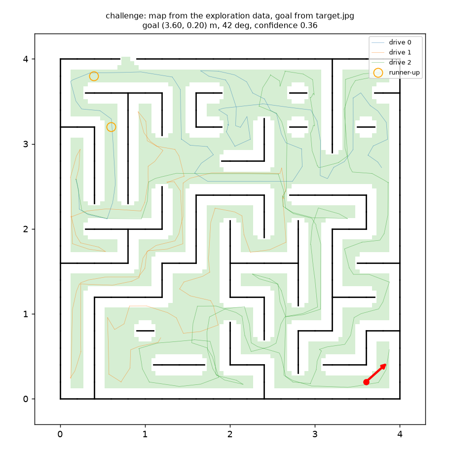

# Stage 9: challenge data, agent display, frame-rate adapter

Plan revision in force: **revision 10** (read from disk; stage 9 as rewritten).

Status: **tasks 0 to 7 done and passing; task 8 (the final holdout evaluation) is not run: it needs your confirmation. Two acceptance items need you:** driving to the goal in `--local 7`, and the confirmation for the holdout run.
- **Adapter:** the detector returns 5 on every local 5-tick dataset and 1 on `tick1-7`, `tick1-8` and the challenge download. Subsampling per-tick recordings gives the native 5-tick data exactly: 100 % of labels equal and every image byte-identical (2,856 and 3,324 frames).
- **Transparency:** a `tick1-7` build is **bit-identical** to the native `gt4-7` build made with the same code (poses, all map arrays, snapped cells, goal).
- **Challenge run:** one command, no edits, **88.5 s** (limit 5 min). The map is a 21 × 21 cell maze; the goal is at (3.60, 0.20) m, 42°, confidence 0.36, reliable.
- **Missing arrow:** I **could not reproduce** it. The root cause is not established (details below).

## What was built

| file | what |
|---|---|
| `source/mapping/adapter.py` (new, pipeline) | `ticks_per_frame`, `decide_k`, `step_to_five_ticks`, `subsample`, `subsample_dataset`, `window_labels` |
| `source/mapping/build_map.py` | `--ticks auto|N` (default `auto`): detect, subsample into `<out>/adapted` if the rate is not 5, write `adapter.json` |
| `source/mapping/record_gt.py` | `--capture-every N` (default 5: no existing recording changes); `record_ticks` writes `data/tick<N>-<seed>`; holdout seeds refused |
| `source/my_agent.py` | the frame-rate detector replaces the name check (`--map` is gone); status reset in `setup()`; the goal result printed; a goal arrow that reads as an arrow |
| `source/mapping/stage9.py` | evaluation: detector table, subsampling check, transparency check, challenge sanity table and figure |
| `tests/mapping/test_adapter.py` | 12 tests: the detector's decision on synthetic evidence, subsampling bookkeeping, the build's adaptation, rule 10 leakage |
| `data/tick1-7`, `data/tick1-8` | per-tick dev recordings (14,287 and 16,627 frames; `msaa=4`) |
| `cache/mapping/stage9/*.json`, `reports/figures/stage9_challenge.png` | every number below |

Reproduce:
```
uv run source/mapping/record_gt.py --seeds 7 8 --msaa 4 --capture-every 1
uv run python source/mapping/stage9.py detect && uv run python -I source/mapping/stage9.py detect-challenge
uv run python source/mapping/stage9.py subsample
uv run python source/mapping/build_map.py --data data/tick1-7 && uv run python source/mapping/build_map.py --data data/gt4-7 --out cache/mapping/build/gt4-7-rebuild
uv run python source/mapping/stage9.py transparency
uv run python -I source/mapping/build_map.py --data data/ab7efaeb1abf
uv run python -I source/mapping/stage9.py sanity cache/mapping/build/ab7efaeb1abf --name challenge
```

## Task 0: leakage and import checks

- **Static scan:** `adapter.py`, `build_map.py` and the agent's map path name no `gt.json`, `poses.json`, `camera_fit`, `record_gt` or `vis_nav_sim`. The agent no longer names `five_tick_data` (tests).
- **Identical output:** `subsample` and the detector's evidence on a truncated per-tick drive are identical with and without `gt.json` / `poses.json` next to it (test).
- The existing `build_map` leakage test needed one change: its 40-frame copies are too short for the detector, which raises on too little evidence rather than guess. The test now passes `--ticks 5`.

## Task 1: the frame-rate detector

`ticks_per_frame(data)` measures how far the robot moves and turns between consecutive frames, in ticks, from the data alone:
- **(b)** the median scan-ICP forward motion on FORWARD-after-FORWARD pairs, over 0.03 m;
- **(c)** the median compass change on LEFT/RIGHT-after-the-same pairs, over 3.44°;
- **(a)** the label-repeat rate, which must agree.

`k` is the rounded median of (b) and (c); it raises if they round differently, if k is outside 1 to 10, or if (a) disagrees (repeat rate at least 0.65 for k = 1, below for any other k). Each dataset takes 14 to 25 s (240 pairs per drive).

| dataset | k | (a) repeat rate | (b) forward, ticks | (c) turn, ticks | pairs (b / c) |
|---|---|---|---|---|---|
| `gt4-7`, `-8`, `-9`, `-10` | **5** | 0.44 to 0.46 | 4.96 to 5.00 | 4.87 to 4.89 | 324 to 369 / 643 to 696 |
| `gt-7`, `-8`, `-9`, `-10` | **5** | 0.44 to 0.46 | 4.97 to 4.99 | 4.85 to 4.89 | 325 to 374 / 634 to 686 |
| `tick1-7`, `tick1-8` | **1** | 0.80 | 0.99 to 1.00 | 1.00 | 648, 661 / 703, 700 |
| `ab7efaeb1abf` (challenge) | **1** | 0.80 | 1.01 | 1.03 | 680 / 693 |

(c) reads 4.9 rather than 5.0 at 5 ticks because a LEFT window often starts with another action (stage 0: 62 % of windows mix). The median is not affected enough to change the rounding; (b) and (c) are 0.1 apart.

The evidence is recorded in `adapter.json` of every build.

## Task 2: per-tick recordings

`data/tick1-7` and `data/tick1-8` (dev seeds, `msaa=4`) are the same mazes, routes and noise as `gt4-7` and `gt4-8`. **5-tick frame j is per-tick frame 5j + 4**, byte-identical (60 of 60 compared per drive at that offset; 0 to 14 of 60 at any other offset). A per-tick drive has 1 to 4 trailing frames after the last 5-tick one.

## Task 3: subsampling

`subsample` keeps frames 4, 9, 14, ... (offset k − 1: the first saved frame is k ticks after the spawn, as locally). Its `action` is the last tick's label; `composition` counts every action over the window.

| | frames | labels equal | images identical | composition sums to 5 |
|---|---|---|---|---|
| `tick1-7` vs `gt4-7` | 2,856 | 2,856 (100 %) | 2,856 (maximum pixel difference 0) | 2,856 |
| `tick1-8` vs `gt4-8` | 3,324 | 3,324 (100 %) | 3,324 (maximum pixel difference 0) | 3,324 |

The subsampling step is `5 / k` frames: `step_to_five_ticks` raises for a k that does not divide 5 (2, 3, 4, 10), because 5-tick spacing cannot be reached exactly.

**A bug I made and fixed:** the first `build_map --ticks` passed the detected rate k as the step, so the first `tick1-7` build ran on every per-tick frame and took 23 minutes. I found it from the pose arrays' length (3,616 against 723) in the transparency check. The step is `5 / k` now, and a test builds from a tiny per-tick dataset.

## Task 4: `build_map.py --ticks`, and the transparency check

`tick1-7` built with `--ticks auto`: detected k = 1, subsampled to every 5th frame, then the normal five steps.

**`tick1-7` against the native `gt4-7` build made with the same code (`gt4-7-rebuild`):**

| | result | threshold |
|---|---|---|
| poses (2,856) | **identical**: maximum difference 0.0 m | within 1 mm |
| snapped wall cells | identical (458 and 458) | identical |
| goal | identical: (5.0001, 0.3976) m, 138.7°, difference 0.0 m, 0.0° | within 1 cm |
| every `map.npz` array, key set, `target.jpg` | identical | |

The stored `gt4-7` build (made earlier, in the VM) differs from `tick1-7` by up to **1.18 mm** (median 0.25 mm) and has a different key set (`lattice_phase`, `lattice_phase_raw` are missing): it predates a change in `grid.py`. Wall cells and goal are identical against it too. Against a rebuild with the current code there is no difference at all, which is the right comparison. The rebuild is `cache/mapping/build/gt4-7-rebuild/`.

Timing on a quiet machine: `gt4-7` rebuild 137 s (adapter detection 14.6 s, inputs 55 s, odometry 33 s, closures 24 s, graph 2.5 s, map 7.7 s); the `tick1-7` build took 223 s while other jobs were running.

## Task 5: the agent

**5a, the missing red arrow: not reproduced.**
- `info.targets` of `local_session('local:7')`: four 240 × 320 uint8 views, `color_order` bgr. They differ from the corresponding views of `target.jpg` by 0.9 to 1.3 grey levels on average as is, and by 6.7 to 15.5 with the channels reversed. So the live views are BGR, like the file.
- `goal.place` on `target.jpg`: (5.00, 0.40) m, 138.7°, confidence 0.288, reliable. On `info.targets`: (5.001, 0.398), 138.7°, 0.263, reliable. Channel-swapped views would give 0.084, i.e. below 0.10, which would draw an orange arrow: that is not what the live views give.
- With the pre-flight and the real `setup()` in the order the SDK calls them (junk targets, then real), through `run()` against `local:7`: the junk placement gives (0.16, 5.03), confidence 0.007; the real one gives the goal at (5.00, 0.40) with confidence 0.263 and the panel holds the red arrow (304 red pixels at the old size).
- Through the SDK viewer on SDL's dummy video driver, the real window shows the arrow near (5.0, 0.4).

I could not find a failing path. The candidates:
- *RGB instead of BGR:* no, see above.
- *a different rendering of the live goal views:* a small difference only (1 grey level).
- *an exception swallowed in `setup()`:* none occurs on this path; `setup()` now prints the goal result or the exception to the terminal, so a silent failure cannot hide again.
- *the arrow drawn orange because confidence < 0.10:* not here (0.26).
- *the earlier arrow looking like a dot:* a plausible contributor. It was 0.3 m long on a map that had been shrunk, so about 9 px with a 6 px dot covering its head. It is now a fixed 16 px arrow with a 3 px dot, and in the headless window it reads as an arrow pointing up-left, matching 139°.

If the arrow is still missing in your window, the terminal now prints `goal on the map: ...` or the failure; please send that line.

**Changes:** `setup()` resets the status line; `--map` is removed; the frame-rate detector (through `build_map.py`) replaces the `five_tick_data` name check, so a challenge download builds without flags. Nothing else in the agent's display changed. **5c (the HUD goal line in the arrow's colour) does not apply:** you removed the agent card from the window. The goal result is printed to the terminal instead.

**The agent on the challenge data without `--map`:** constructed from the cached challenge build, with the four views of `target.jpg` given to `setup()` (no session, nothing touches the server): `status: map: cache/mapping/build/ab7efaeb1abf (1 tick(s) per frame, scale corrected +0.91 %)`, `goal on the map: x 3.60 y 0.20 m, heading 42 deg, confidence 0.36 (reliable)`, and 261 red pixels in the panel.

## Task 6: the challenge run

`python -I source/mapping/build_map.py --data data/ab7efaeb1abf`, no ground truth, parameters frozen:

| step | time |
|---|---|
| adapter (detect 1 tick per frame, subsample to every 5th) | 25.3 s |
| inputs | 26.0 s |
| odometry | 16.8 s |
| closures | 13.0 s |
| graph | 3.4 s |
| map | 4.1 s |
| **total** | **88.5 s** (limit 300 s) |

Then `goal.place` on `target.jpg`: **(3.60, 0.20) m, heading 42°, confidence 0.357, reliable**, camera height 0.160 m. Figure: `reports/figures/stage9_challenge.png`.



## Task 7: sanity checks without ground truth

The dev builds are `gt4-7` (rebuilt), `gt4-8`, `gt4-9`, `gt4-10`, all built with the same `build_map.py`. For the test seeds I use the ranges the plan and reports 4b to 8 already state, and did not read any test-seed result.

| value | challenge | dev range (4 builds) | in range? |
|---|---|---|---|
| detected rate; evidence (b / c / repeat) | **1**; 1.01 / 1.03 / 0.80 | 5; 4.96 to 5.00 / 4.87 to 4.89 / 0.43 to 0.46 | the rate is the point of the adapter |
| calibrated speed scale per drive | 0.952, 1.069, 1.009 | 0.997 to 1.004 (drive 0) | yes (plan: 0.9 to 1.1); per-drive scales differ as stage 4b found |
| calibrated turn scale | 1.033 | 0.984 to 1.003 | yes (a little high) |
| closures | 692 (boundary 112, gate 580) | 1,121 to 1,737 | fewer: a smaller maze with fewer frames (1,440 against 2,856 to 3,324) |
| closures by drive pair | 0–1: 28, 0–2: 140, 1–2: 199 (within a drive: 76, 34, 215) | 0–1: 12 to 211, 0–2: 159 to 332, 1–2: 118 to 727 | yes, every pair joined |
| closures dropped by the chi-square re-check | 0 | 0 to 1 | yes |
| graph cost per edge (chi-square) | 0.02 over 1,778 edges | 0.02 to 0.03 over 3,453 to 4,018 | yes |
| lattice scale / strength | 0.9910 / 0.960 | 0.9879 to 0.9987 / 0.917 to 0.962 | yes |
| cell size | 0.2000 m | 0.2000 m | yes |
| snapped wall cells | **209** | 440 to 474 (plan: 420 to 480) | **outside; explained below** |
| maze size, from the wall cells | **21 × 21 cells** | 31 × 31 (one 32 × 31) | different maze size |
| outer wall closed (bounding-box ring filled) | not quite: 98.8 % | 100 % on 2 of 4; 99.2 % and 74.6 % on the others | within the dev spread |
| configuration-space cells | **3,075** | 6,275 to 6,902 | **outside; same explanation** |
| goal camera height | 0.160 m | 0.160 m | yes |
| goal confidence / overlap residual | 0.357 / 0.002 | 0.244 to 0.308 / 0.001 to 0.005 (test, stage 8: 0.31 to 0.38) | yes |
| runtime | 88.5 s | 137 s on a quiet machine | yes |

**The two values outside the range have one cause: the challenge maze is smaller.** Its wall cells span 21 × 21, not 31 × 31, and 458 × (21/31)² = 210 matches the 209 snapped cells; 6,527 × (21/31)² = 2,995 matches the 3,075 free-space cells. The challenge's exploration also has fewer frames (1,440 against 2,856 to 3,324 at 5-tick spacing). The challenge map looks like a maze (figure): closed outside wall except a small gap near the top left, corridors that the drives follow, the goal in the bottom right corner. A different maze size is a fact about this challenge, not a symptom of failure; the sanity values that are scale-free (lattice, graph cost, closures per frame pair, goal height, confidence) are all in range.

**What this cannot show:** accuracy. There is no ground truth for the challenge. The checks say the pipeline behaved as it does on dev; they do not say the map is right.

## Task 8: the final holdout evaluation

**Not run.** The plan requires tasks 0 to 7 to pass, the pipeline to be frozen, and your confirmation. Tasks 0 to 7 pass. The pipeline has changed since stage 8 only by the adapter and `build_map`'s new default (`--ticks auto`; the detector must return 5 on the holdout's 5-tick recordings, which `final_eval.py build` goes through). When you confirm:
```
python3 source/mapping/final_eval.py --final build 31   # ... 32 33 34 35
python3 source/mapping/final_eval.py --final score 31,32,33,34,35
```
No fixes after that run. I have not opened any holdout seed.

## Acceptance

| criterion | result | |
|---|---|---|
| Leakage and import checks for `adapter.py`, `build_map.py`, the agent's map path | pass (tests) | pass |
| Detector returns 5 on every local 5-tick dataset (dev; holdout through `final_eval`), 1 on `tick1-7`, `tick1-8` and the challenge, evidence reported | 5 on 8 dev datasets (`gt` and `gt4`), 1 on the three per-tick datasets; the holdout goes through `final_eval` | pass |
| Subsampled `tick1` equals native 5-tick: labels 100 %, images identical | 100 %; maximum pixel difference 0 | pass |
| Transparency: poses ≤ 1 mm, same snapped cells, goal ≤ 1 cm | identical (against a same-code rebuild) | pass |
| `--local 7` shows the red arrow at the true goal, root cause of the earlier missing arrow stated; the user drives to it and checks in | arrow at (5.0, 0.4) in the real SDK flow; **root cause not found**; **the drive and check-in are yours** | **open** |
| Challenge: end to end with no manual edits, < 5 min; every sanity value in range or explained | 88.5 s; all in range except two values explained by a 21 × 21 maze | pass |
| Final holdout evaluation done once with your confirmation | not run | **waiting for you** |
| Optional composition prior | not built | skipped |

## Disclosure and open issues

- No test seed was scored or opened for this stage. All tuning and checks used dev seeds 7 to 10, the per-tick dev recordings and the challenge download.
- **`tests/test_agents.py::test_the_template_agent_is_a_complete_skeleton` fails**, and did before this stage: it expects `act()` to raise `NotImplementedError`, and the agent keyboard-drives. All other tests pass (196).
- The detector needs about 20 FORWARD and 20 turn pairs; a drive far shorter than that raises (`AdapterError`) rather than guesses.
- Data at 2, 3, 4 or 10 ticks per frame is detected but not adapted (`step_to_five_ticks` raises). The server's data so far has been 5 or 1.
- The challenge's per-drive speed scales (0.95, 1.07, 1.01) are what stage 4b predicted: a separate motion bias per route.
- Not changed: `topdown_map_plan.md`, `CLAUDE.md`. Both could use a note that stage 9 is done and that the challenge maze is 21 × 21.
